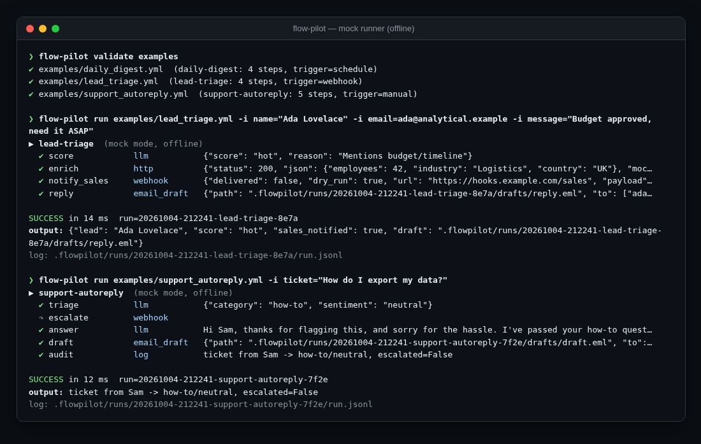
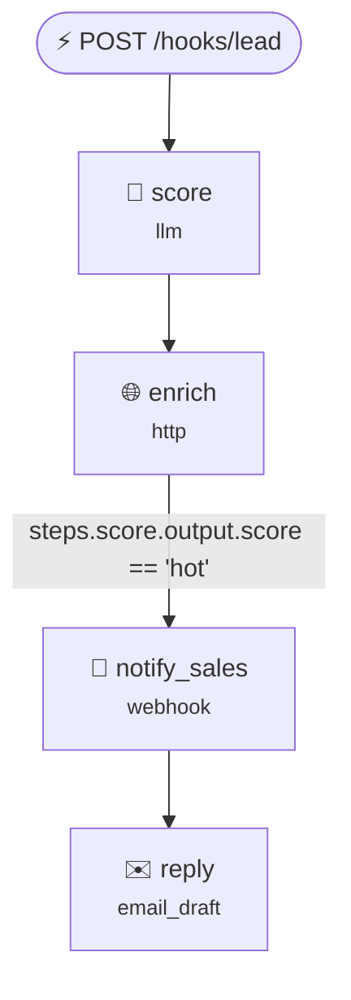

<div align="center">

# 🛫 flow-pilot

**AI automation workflows defined in YAML: triggers, LLM steps, HTTP calls, webhooks and email drafts. A safe
mock runner means you can build and test every flow offline before anything touches the real world.**

[](https://github.com/hbtabi/flow-pilot/actions/workflows/ci.yml)


[](LICENSE)

</div>

Think of a tiny, code-first Zapier/n8n for the AI era. Each workflow is a readable YAML file you can review in a PR.
Steps pass data to each other with Jinja templates, and every run leaves a JSONL audit log. In mock mode (the
default) LLM and HTTP steps return canned or templated mock data and webhooks are only recorded, so CI can run
your automations on every commit. Add `--live` when you're ready.

## 📸 Demo

<p align="center"></p>

`flow-pilot graph examples/lead_triage.yml` prints a Mermaid diagram, which GitHub renders:



## ✨ Features

- **Triggers**: `manual`, `webhook` (`flow-pilot serve`, optional shared-secret header) and `schedule` (`every: 15m`)
- **Step types**: `llm` (text or JSON output), `http` (with `expect_status`), `webhook`, `email_draft` (writes an
  `.eml` for a human to review, **never sends**), `transform`, `log`
- **Data flow**: sandboxed Jinja2. A field that is exactly `{{ expr }}` keeps its native type (lists, dicts, bools)
- **Control**: `when:` conditions, `retries:` with exponential back-off, `on_error: continue`
- **Validation**: `flow-pilot validate` catches unknown step types, missing fields, duplicate ids, and references to
  steps that haven't run yet, before you run anything
- **Run logs**: `.flowpilot/runs/<run-id>/run.jsonl` + `result.json` + `drafts/`, with env secrets redacted from
  everything written to disk; browse them with `flow-pilot runs [id]`
- **LLM**: any OpenAI-compatible API (`OPENAI_API_KEY`, `OPENAI_BASE_URL`, `OPENAI_MODEL`). Live mode quietly
  falls back to the step's mock when no key is set
- Two runtime dependencies (PyYAML, Jinja2); everything else is the standard library

## 🚀 Quick start

```bash
git clone https://github.com/hbtabi/flow-pilot && cd flow-pilot
python -m venv .venv && source .venv/bin/activate
pip install -e ".[dev]"

flow-pilot validate examples
flow-pilot run examples/lead_triage.yml -i name="Ada Lovelace" -i email=ada@example.com -i message="budget approved"
flow-pilot runs                                   # history
flow-pilot graph examples/support_autoreply.yml   # Mermaid diagram

flow-pilot serve examples --port 8787             # webhook trigger (mock mode)
curl -X POST localhost:8787/hooks/lead -d '{"name":"Ada L","email":"a@b.co","message":"budget ready"}'

flow-pilot schedule examples                      # runs `schedule` workflows on their interval
flow-pilot run examples/daily_digest.yml --live   # real HTTP + LLM calls (needs .env values exported)
```

## 🧩 Writing a workflow

```yaml
name: support-autoreply
trigger: manual
inputs:
  ticket: { required: true }
steps:
  - id: triage
    type: llm
    json: true
    prompt: 'Classify: {{ inputs.ticket }}. Return {"category": ..., "sentiment": ...}'
    mock: { category: billing, sentiment: "{{ 'angry' if '!' in inputs.ticket else 'neutral' }}" }
  - id: escalate
    type: webhook
    when: "{{ steps.triage.output.sentiment == 'angry' }}"
    url: "{{ env.get('ESCALATION_WEBHOOK_URL', 'https://hooks.example.com/escalations') }}"
    json: { ticket: "{{ inputs.ticket }}" }
  - id: draft
    type: email_draft
    to: customer@example.com
    subject: "Re: your {{ steps.triage.output.category }} request"
    body: "Thanks for reaching out..."
output: "{{ steps.triage.output }}"
```

Template context: `inputs`, `steps.<id>.output|status|error`, `env`, `run.id|mode|started_at`.
Mock values can be templated too, so offline runs still branch realistically.

## 🗂️ Project structure

```
flowpilot/
  workflow.py    schema, loading, validation (friendly errors)
  templating.py  sandboxed Jinja2, native-type expressions, step-reference analysis
  steps.py       llm / http / webhook / email_draft / transform / log
  engine.py      runner: when, retries, on_error, JSONL logs, secret redaction
  server.py      webhook trigger server (stdlib)
  graph.py       Mermaid export
  llm.py         OpenAI-compatible client (stdlib)
  cli.py         validate | run | runs | graph | serve | schedule
examples/        lead triage (webhook), daily digest (schedule), support auto-reply (manual)
tests/           templating, validation, engine (incl. live HTTP against a local server), CLI & server
```

## 🛣️ Roadmap

- [ ] Parallel branches (`needs:`) and `foreach` over lists
- [ ] Cron expressions for schedules, plus persisted next-run state
- [ ] More steps: Slack/Discord native, Google Sheets append, Python function steps
- [ ] Small web UI for run history and draft approval ("human in the loop")
- [ ] Record & replay: capture live responses as mocks automatically

## ⚠️ Limitations

- Single process and sequential: no queue, no distributed workers, no exactly-once guarantees.
- The scheduler is a simple in-process interval loop. Use cron/systemd for production schedules.
- The webhook server is for local use and trusted networks: shared-token auth only, no TLS, no rate limiting.
- `env` is visible to templates (that's how URLs and keys get in). Values of `*KEY*/*TOKEN*/*SECRET*` vars are
  redacted from logs, but a workflow author can still send them anywhere, so only run workflows you trust.
- Mock LLM output is whatever you write in `mock:`. It tests the *plumbing*, not prompt quality.

## 📄 License

[MIT](LICENSE) © 2026 Mohammed Hassan bin Tayyeb
